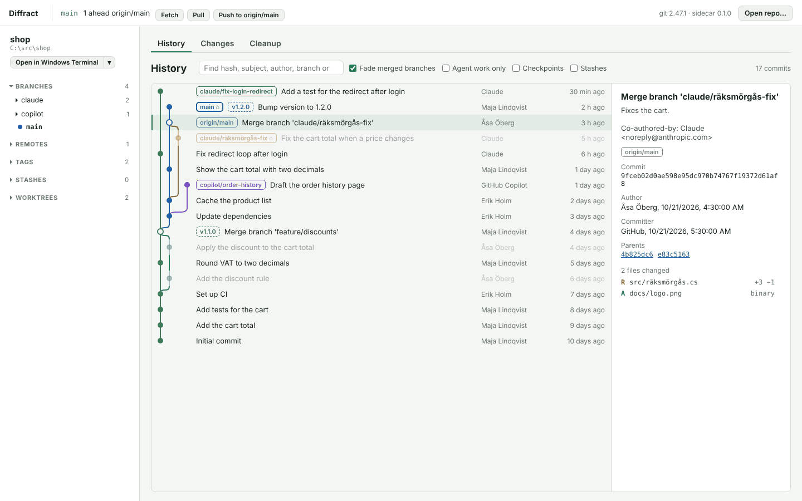
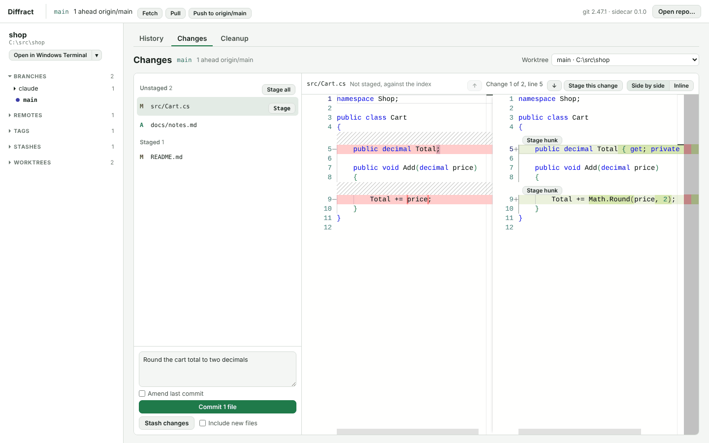
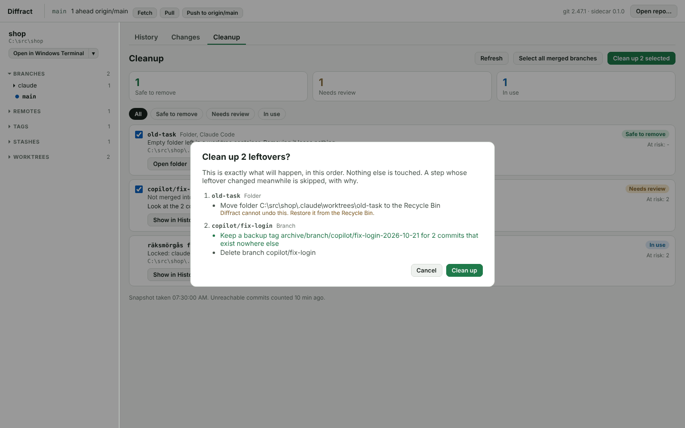
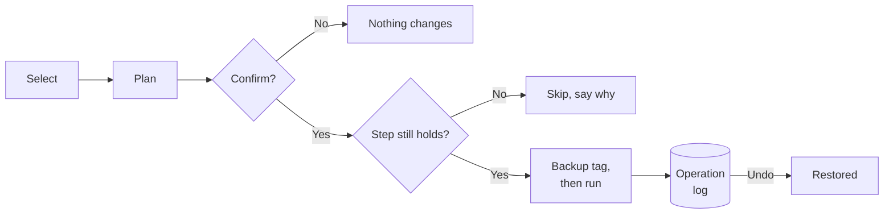
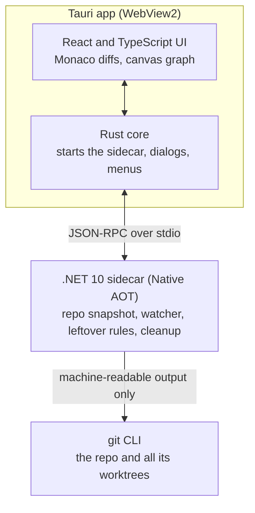

<h1 align="center">Diffract</h1>

  A modern Git desktop client for Windows that understands worktrees, cleans up after AI agents and makes rebases less scary.

  
  
  
  
  
  

  <picture>
    <source media="(prefers-color-scheme: dark)" srcset="docs/images/history-dark.png">
    
  </picture>
   
  Screenshots show sample data.

## Why Diffract

AI coding agents create worktrees, branches and checkpoints faster than anyone cleans them up. Most Git clients do not know what an agent is. Diffract does.

- **Worktrees first.** Every worktree with its branch and state, and whether an agent is using it right now.
- **Agent cleanup.** Finds what Claude Code and GitHub Copilot leave behind. Each row says Safe to remove, Needs review or In use.
- **Never loses work.** Cleanup is plan, then apply. Unique work gets a backup tag first, and every step can be undone.
- **A daily driver.** History, staging by file or hunk, commit, pull, push, branches, tags and stashes.
- **Fast and live.** A 50,000-commit history shows its first rows within a second, and the views follow what agents and editors change as it happens.

## What it does

### History

A canvas-drawn commit graph that only draws the rows in view. Agent branches, checkpoints and stashes are marked, merged branches fade, and a toggle shows agent work only. Right-click a commit to create a branch or tag, switch, or reset the current branch with an undo.

### Changes

Stage whole files or single hunks in the same Monaco diff, commit or amend, then fetch, pull and push from the top bar. Pull only fast-forwards, nothing ever forces, and git's output shows in a command window.

  <picture>
    <source media="(prefers-color-scheme: dark)" srcset="docs/images/changes-dark.png">
    
  </picture>

### Cleanup, with undo

Worktrees, branches, remote-tracking branches, stashes, checkpoint sessions, old backup tags, leftover folders and orphaned commits, each classified by rules. Pick what to remove and the dialog shows every step before anything runs.

  <picture>
    <source media="(prefers-color-scheme: dark)" srcset="docs/images/cleanup-dark.png">
    
  </picture>

### And the rest

A sidebar with branches, remotes, tags, stashes and worktrees. Stash, apply and drop with undo. Open a terminal in any worktree. A git version check at startup that offers to update Git for Windows through winget, and only after you confirm.

## Safe by design

The dialog and the real operation come from the same plan, so they cannot disagree. Agents keep working while the dialog is open, so every step checks that what it expects is still true.

- Rows marked In use are never offered.
- Nothing is forced, and no lock file is ever deleted.
- Coding agents never write to a real repo while building Diffract. Every test uses a throwaway fixture repo in a temp folder.

## How it works

- **The git CLI only.** No git libraries. Output is always machine-readable, and arguments are never built into a command string.
- **Snapshots and pure rules.** One immutable snapshot per refresh, and leftover rules are pure functions over it, so they are easy to test.
- **Three runners.** Reads, changes and cleanup each go through a runner that allows only an explicit list of commands. A test proves every other command is rejected before a process starts.

## Install

You need Windows 11 (WebView2 comes with it) and Git for Windows 2.40 or newer.

Every CI run builds an installer. Open the latest [CI run on main](https://github.com/johanpearson/Diffract/actions/workflows/ci.yml?query=branch%3Amain), download the `diffract-installer` artifact (it needs a GitHub login) and run the `.exe`. It is unsigned for now, so Windows SmartScreen will warn.

To build it yourself, see [docs/setup.md](docs/setup.md).

## Roadmap

The plan lives in GitHub, not in the repo. [Milestones](https://github.com/johanpearson/Diffract/milestones) group the work and every piece is an [issue](https://github.com/johanpearson/Diffract/issues).

- **Now:** finishing safe cleanup, such as pruning remote branches and discarding changes with undo.
- **Next:** repo settings, clone, init, recent repos, several repos at once, blame and the history of one file.
- **Then:** merge and conflict resolution, and interactive rebase, which completes v1.

Not in v1: macOS and Linux, hosting integration such as pull requests and issues, and a plugin system.

## Contributing

This is a personal project. Ideas and bugs are welcome as [issues](https://github.com/johanpearson/Diffract/issues/new/choose), and every change starts as one. A pull request starts with `Closes #<issue>`, and CI must pass before it merges.

Much of Diffract is built by coding agents, under the rules in [AGENTS.md](AGENTS.md).

More: [what Diffract is and the decisions that are locked](docs/brief.md) · [setting up a machine](docs/setup.md) · [merging PRs and what protects main](docs/github.md) · [what git really does, measured](docs/findings) · [the visual plan](docs/visual-plan.html) (open it in a browser)
